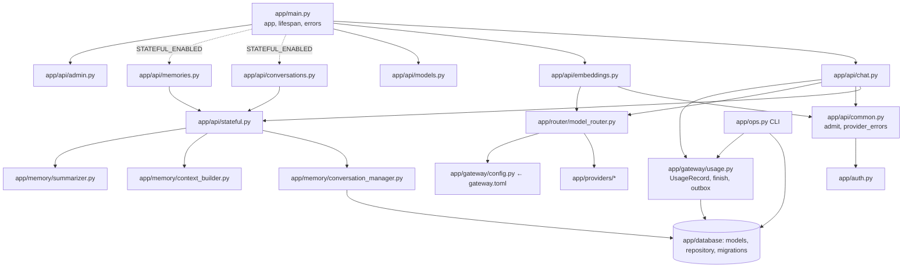
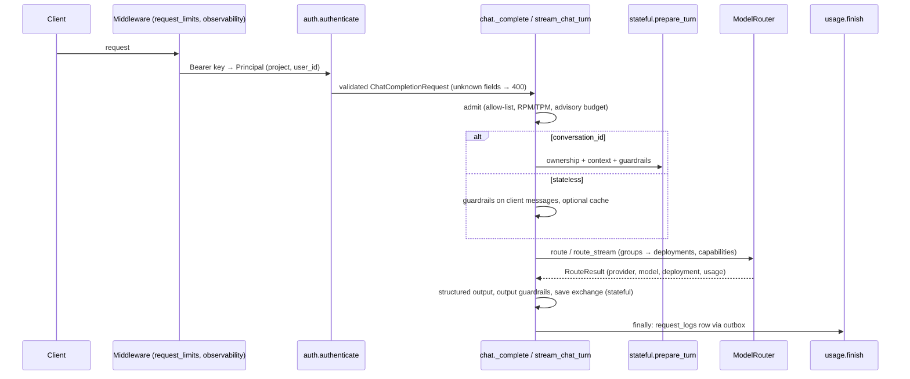

# TwinLM codebase graph

Read this first, before opening files. It is a **navigation index**:
[ARCHITECTURE.md](ARCHITECTURE.md) is the authority for design decisions, and
nothing here proves the code works — the tests do.

- Machine-readable nodes/edges: [`codebase-graph.json`](codebase-graph.json) (≈130 nodes, ≈260 edges)
- Check: `python scripts/codebase_graph.py` — fails on stale paths/symbols,
  app modules without a node, curated edges whose target isn't referenced in
  the source function/module, and stale generated routes/imports.
- After code changes: fix curated edges, then `python scripts/codebase_graph.py --update`
  (refreshes generated `imports`/`routes_to` and the `source` stamp: git
  revision, dirty flag, content fingerprint). A fingerprint warning = code
  changed since the graph was last reviewed.

Edge types: `imports`, `routes_to` (generated from the AST); `calls`,
`reads`, `writes`, `tests`, `configures`, `routes_provider` (curated).
Curated edges marked `"inferred": true` are not mechanically verified
(indirect calls via helpers, config-driven routing, tests→module coverage).
Dynamic FastAPI wiring is listed under `annotations` in the JSON.

## System graph

## Request flow (`POST /v1/chat/completions`)

## Where should I edit?

| Behavior | Edit | Tests |
| --- | --- | --- |
| Accepted chat fields, unknown-field policy | `app/schemas/chat.py` (`_StrictWire`, `ChatCompletionRequest`), error shape in `app/main.py` | `tests/test_ownership.py`, `test_openai_compat.py`, `test_sdk_contract.py` |
| Stateless pipeline order (admit → guard → cache → route → validate) | `app/api/chat.py` (`_complete`, `stream_chat_turn`) | `test_openai_compat.py`, `test_gateway_api.py` |
| Conversation context, ownership, summaries | `app/api/stateful.py`, `app/memory/*` | `test_ownership.py`, `test_chat.py`, `test_memory.py` |
| Who may access what (keys, users, admin) | `app/auth.py`, `app/api/stateful.py` (`bound_user`, `owner_for`), `app/api/admin.py` | `test_ownership.py`, `test_gateway_api.py` |
| Aliases, deployments, groups, capabilities, fallback order | `app/router/model_router.py` (`_plan`, `_order`, `build_router`), `app/gateway/config.py`, `gateway.toml` | `test_deployments.py`, `test_router.py`, `test_resilience.py` |
| Retries, timeouts, circuit breaker | `app/router/model_router.py` (`_call`, `route_stream`), `app/gateway/health.py`, `app/gateway/retry.py` | `test_resilience.py` |
| A provider's wire format / usage parsing | `app/providers/gemini.py`, `openai_compatible.py`, `base.py` (`TokenUsage.reported`) | `test_providers.py`, `test_accounting.py` |
| Add a provider type | `app/providers/<new>.py`, `build_provider` + `DEFAULT_CAPABILITIES` in `model_router.py`, `ProviderConfig.type` | `test_providers.py` |
| Admission: rate limits, budget | `app/api/common.py` (`admit`), `app/gateway/rate_limit.py` | `test_gateway_api.py` |
| Output caps, cache eligibility/TTL | `app/gateway/config.py` (`output_cap`, `cache_ttl`), `app/api/chat.py` (`_checked_generation_params`, `_complete`) | `test_cost_controls.py` |
| Savings report | `app/api/admin.py` (`savings`), `app/database/repository.py` (`savings_rows`) | `test_cost_controls.py` |
| Cost/usage accounting, outbox | `app/gateway/usage.py`, `app/gateway/pricing.py`, `app/database/repository.py` (`usage_summary`) | `test_accounting.py`, `test_gateway_api.py`, `test_ops.py` |
| Schema change | model in `app/database/models.py` + new entry appended to `MIGRATIONS` in `app/database/database.py` | `test_ops.py` (SQLite; PostgreSQL with `TEST_DATABASE_URL`) |
| Operator commands (migrate, retention, outbox) | `app/ops.py`; runbook `docs/OPERATIONS.md` | `test_ops.py` |
| Guardrails / structured output | `app/gateway/guardrails.py`, `app/gateway/structured.py` | `test_gateway_api.py` |
| Settings / env switches | `app/config.py`, `.env.example` | — |
| Compose, ingress, alerts, images | `docker-compose.yml`, `deploy/Caddyfile`, `monitoring/alerts.yml`, `Dockerfile`, `requirements*.lock` | CI `deploy-config` job |
| Benchmarks | `loadtest/bench.py`, `loadtest/gateway.bench.toml`, `loadtest/run.py` | results in `docs/PERFORMANCE.md` |

## Key nodes

| Node | Path | Purpose |
| --- | --- | --- |
| `app.main` | `app/main.py` | App assembly; conditional routers; migrations at startup; `/health` `/ready` `/metrics` |
| `chat_completions`, `_complete`, `stream_chat_turn` | `app/api/chat.py` | Chat entry, non-streaming and streaming pipelines |
| `prepare_turn`, `maybe_summarize`, `owner_for` | `app/api/stateful.py` | The only path into conversation/memory data |
| `admit`, `provider_errors` | `app/api/common.py` | Admission; exception → HTTP mapping |
| `authenticate`, `Principal` | `app/auth.py` | Key → project, limits, optional `user_id` |
| `ModelRouter`, `Deployment`, `_plan`, `build_router` | `app/router/model_router.py` | Routing engine and config wiring |
| `GatewayConfig`, `DeploymentConfig`, `ModelAliasConfig` | `app/gateway/config.py` | `gateway.toml` schema |
| `UsageRecord`, `finish`, `UsageWriter` | `app/gateway/usage.py` | Accounting and durable outbox |
| `init_db`, `MIGRATIONS`, `release_connection` | `app/database/database.py` | Versioned migrations; session handling |
| Tables | `app/database/models.py` | `conversations`, `messages`, `memories`, `api_keys` (+`user_id`), `request_logs` (+`deployment`) |
| `app.ops` | `app/ops.py` | Operator CLI |
| Providers | `app/providers/{gemini,openai_compatible,mock,groq}.py` | Wire translation; `base.py` interface + errors |

Request entry points (generated, see `route:*` nodes): `POST /v1/chat/completions`,
`POST /v1/embeddings`, `GET /v1/models`, `/v1/conversations*`, `/v1/memories*`
(stateful only), `/admin/{providers,models,usage,keys,keys/{id}/rotate,cache}`,
`/health`, `/ready`, `/metrics`, and the optional web UI routes in
`app/web/routes.py`.
